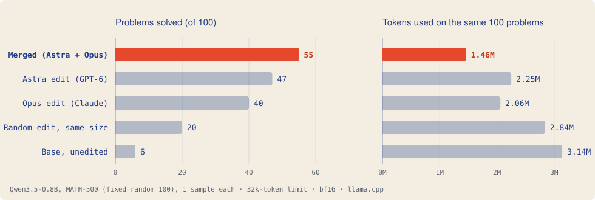

# Weight-Space Programming, Replicated and Stacked

### Two Cures Beat One: AI-Written Weight Edits Replicate, Stack, and Think Shorter

[](LICENSE)
[](NOTICE)


**An independent replication of [*Sparks of Weight-Space Programming*](https://rikiyat.github.io/blog/weight-space-programming/)
(Takehi, Teoh, Zhang & Khattab, MIT CSAIL, 2026), and the first test of *stacking* weight edits written by two
different AIs.**

In weight-space programming, an AI reads a neural network's weights and edits them directly to fix a behaviour,
with no training and no gradients. The MIT paper showed GPT-6 "Astra" lifting Qwen3.5-0.8B from 7.9% to 48.1% on
MATH-500 by editing 0.016% of its weights. We asked three questions:

1. **Does it replicate?** Yes: 46.8% on all 500 problems.
2. **Can a different AI find a different fix?** Claude Opus 5.5 found one, nearly orthogonal to Astra's.
3. **Do two fixes stack?** Yes. Combined, they beat either one alone and use far fewer tokens.

<picture>
  <source media="(prefers-color-scheme: dark)" srcset="results/fig_math500_dark.svg">
  
</picture>

---

## Key findings

| | Finding | Evidence |
|---|---|---|
| 🔁 | **The published edit replicates.** | Astra: 46.8% on all 500 MATH-500 problems (paper 48.1%). Base: 6% (paper 7.9%). Verified bit for bit: 2 tensors, rank 1, layers 15 and 19. |
| ⚙️ | **One setting decides the replication.** | The presence penalty must cover the whole output, as in vLLM. With llama.cpp's default 64-token window, the same edit scores only 28%. |
| 🧠 | **A second AI found a different cure.** | Opus 5.5 diagnosed the model *doubting a correctly read problem* and removed that direction from 24 matrices: 40% alone, vs base 6% (p = 10⁻⁹). Cosine with Astra's direction is about 0.1. |
| ➕ | **The two edits stack.** | Merged: **52.2%** on all 500 vs Astra 46.8% (70 vs 43 problems solved by only one, p = 0.014), and vs Opus 55 vs 40 (p = 0.003). |
| ⚡ | **Stacked, the model thinks far less.** | 31% fewer tokens than Astra on MATH-500 (fewer on 328 problems, more on 69, p ≈ 10⁻⁴¹); 32–66% fewer on MMLU-Pro, GSM8K and MBPP. |
| 🎲 | **The directions matter, not just the size of the edit.** | A random edit of the same size and structure reaches 20%. Merged solves 37 problems it misses, against 2 the other way (p = 3 × 10⁻⁹). |
| ✅ | **No regression.** | Merged is never significantly worse than Astra's edit alone on five benchmarks. |

## Results

### MATH-500, all 500 problems

| | Merged (Astra + Opus) | Astra (GPT-6) |
|---|---|---|
| Correct | **261 (52.2%)** | 234 (46.8%) |
| Solved only by this model | **70** | 43 |
| Answers cut off at 32k tokens | **151** | 190 |
| Total tokens | **7.93M** | 11.50M |

### Controls (MATH-500, first 100, identical problems and seeds)

| Model | Correct | Cut off at 32k | vs base (only this / only base) |
|---|---|---|---|
| **Merged** | **55** | 27 | 49 / 0, p = 4 × 10⁻¹⁵ |
| Astra edit | 47 | 40 | 41 / 0, p = 9 × 10⁻¹³ |
| Opus edit | 40 | 58 | 35 / 1, p = 1 × 10⁻⁹ |
| Random edit, same size | 20 | 80 | 17 / 3, p = 0.003 |
| Base (unedited) | 6 | 95 | — |

The random edit helps a little: base seems to sit on a knife-edge, knowing many answers but unable to stop
reasoning, and any perturbation shakes it out of some loops. The AI-found directions do about 3.5 times as much (+49 points for merged against +14 for the random edit).

### Other benchmarks (merged vs Astra)

| Benchmark | Merged | Astra | Accuracy p | Tokens, merged vs Astra |
|---|---|---|---|---|
| MMLU-Pro (200) | **90 (45.0%)** | 78 (39.0%) | 0.07 | **39% fewer** |
| GSM8K (100) | 68 | **71** | 0.63 | **66% fewer** |
| HumanEval (164, executed) | **57 (34.8%)** | 51 (31.1%) | 0.34 | about equal |
| MBPP (500, executed) | **97 (19.4%)** | 92 (18.4%) | 0.64 | **32% fewer** |

On HumanEval, base scores 47 (28.7%) with 72% more tokens than merged. Base on MMLU-Pro, GSM8K and MBPP is still
running; see [`results/summary.md`](results/summary.md) for every number, with paired McNemar and sign tests.

## How the edits work

Both edits are **directional ablations**: they remove one direction `u` from the matrices that write into the
model's residual stream.

```
W  <-  W - u (uᵀ W)        (‖u‖ = 1)
```

| Edit | Found by | Where | What it removes |
|---|---|---|---|
| **Astra** | GPT-6 (Takehi et al.) | `mlp.down_proj`, layers 15 and 19, 64 columns each | a direction that drives repetition loops |
| **Opus** | Claude Opus 5.5 (this work) | `o_proj` / `linear_attn.out_proj` / `down_proj`, layers 12–23 | a "doubt the problem" direction ("maybe a typo…", "alternatively…"), found from layer-18 activations |
| **Merged** | both | the Opus edit, then Astra's exact weight difference added on top | both |

The doubt direction is in [`edits/doubt_direction_u.json`](edits/doubt_direction_u.json): 1,024 numbers.

## Reproduce

```bash
pip install torch safetensors huggingface_hub datasets math-verify numpy

# 1. Build the edits from the public checkpoints (bit-identical to the files we evaluated)
python scripts/apply_edits.py --edit opus   --out opus_edit.safetensors
python scripts/apply_edits.py --edit merged --out merged_edit.safetensors
#    or a complete model directory:
python scripts/apply_edits.py --edit merged --full --out qwen3.5-0.8b-merged

# 2. Evaluate through llama.cpp's llama-server (Docker needed for the code benchmarks)
LLAMA_SERVER=/path/to/llama-server bash runners/lane.sh merged 8090 6 math500,math500rest

# 3. Summarise
WSP_ROOT=. python scripts/summarize.py
```

**Settings for every run:** thinking on; temperature 0.6, top_p 0.95, top_k 20; presence penalty 1.5 with
`repeat_last_n` = 32,768 (whole output); at most 32,768 new tokens; one sample per problem, with a per-problem seed
shared by all models; bf16 weights; llama.cpp b11960; one RTX 5080 (16 GB).

**Per-problem outputs** (every model answer, about 16 MB zipped) are attached to the
[GitHub release](../../releases).

## Repository layout

| Path | Contents |
|---|---|
| `edits/` | Opus's doubt direction (JSON and `.pt`) |
| `scripts/apply_edits.py` | Build the Opus or merged edit; `--check` verifies bit-identity against a reference |
| `scripts/diff_weights.py` | Verify the published Astra edit (changed values, rank 1) |
| `scripts/make_variants.py`, `scripts/make_random_merged.py` | Write edited tensors into bf16 GGUFs; build the random control |
| `scripts/run_llama_eval.py`, `scripts/benches.py`, `scripts/eval.py` | Evaluation runner, graders, Docker sandbox for code |
| `scripts/summarize.py`, `scripts/make_figure.py` | Tables, paired tests and the figure above |
| `runners/lane.sh` | One model on its own llama-server |
| `results/` | `summary.md`, `summary.json`, figures |

## Limitations

- **One seed, one Opus run.** Each problem was sampled once, and Opus attempted the task once. First successes often
  shrink on repetition; more Opus runs are planned.
- **The 32k limit.** Astra's cut-off answers are often still progressing, so a higher limit could narrow its gap to
  merged. The efficiency result holds either way.
- **Base often fails to finish** under these settings, including on MMLU-Pro. Gains over base partly reflect
  finishing, not new knowledge.
- **One model (0.8B).** Larger models loop less and may gain less. A 3–4B test is next.

## Next

A doubt "dial" (scaling the edit up and down), the same recipe on a 3–4B model and on Qwen3.8 Flash-Next,
more AI surgeons under identical rules, and edited models as a warm start for reinforcement learning.

## Citation

```bibtex
@misc{grover2026twocures,
  title  = {Two Cures Beat One: AI-Written Weight Edits Replicate, Stack, and Think Shorter},
  author = {Grover, Ajay},
  year   = {2026},
  note   = {Preprint},
  url    = {https://github.com/ajaygrover/weight-space-programming-stacking}
}

@misc{takehi2026sparks,
  title  = {Sparks of Weight-Space Programming: LLMs can natively read \& write neural network weights},
  author = {Takehi, R. and Teoh, J. and Zhang, A. and Khattab, O.},
  year   = {2026},
  url    = {https://rikiyat.github.io/blog/weight-space-programming/}
}
```

## Licences and credits

- Code: MIT ([`LICENSE`](LICENSE)).
- Qwen3.5-0.8B (Qwen Team) and the Astra edited model (Takehi et al.) are Apache-2.0. Edited weights derived from
  them are distributed under Apache-2.0; changes are listed in [`NOTICE`](NOTICE). Unofficial, and not affiliated
  with the Qwen Team or the original authors.
- Thanks to Takehi, Teoh, Zhang and Khattab for publishing their edited model, logs and code, which made an exact
  replication possible.

## AI-use disclosure

This project studies AI agents editing weights, and AI assisted throughout. Claude Opus 5.5, run as a separate
agent, wrote the second weight edit as the experimental subject. Claude built and ran the evaluation pipeline and
drafted text under the author's direction. Ajay Grover directed the research and is responsible for all claims.
